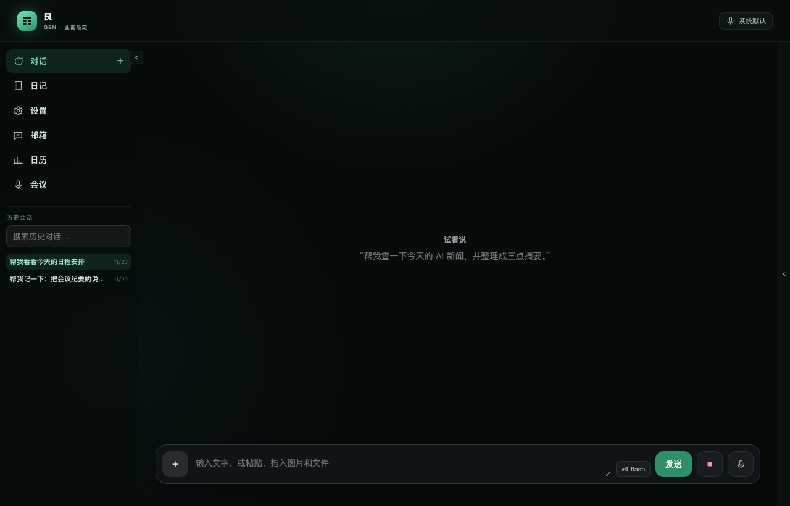
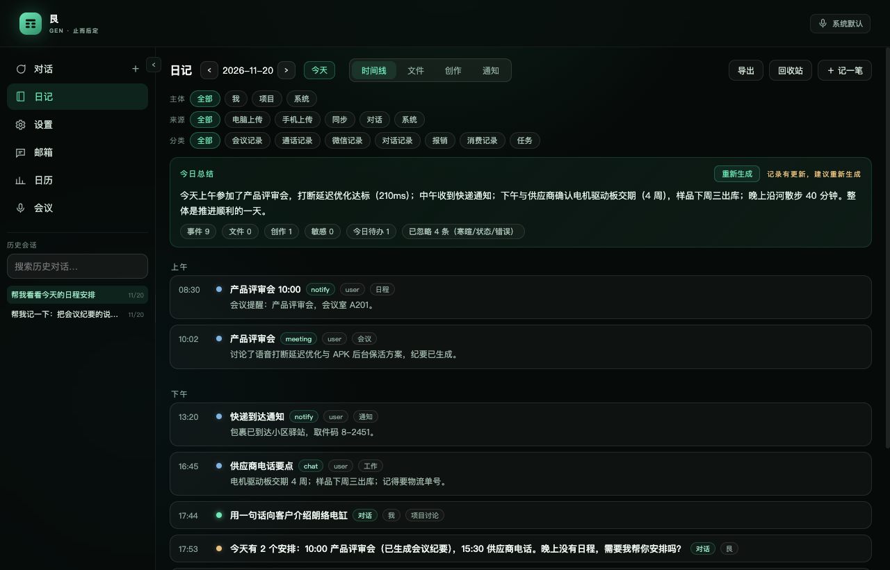
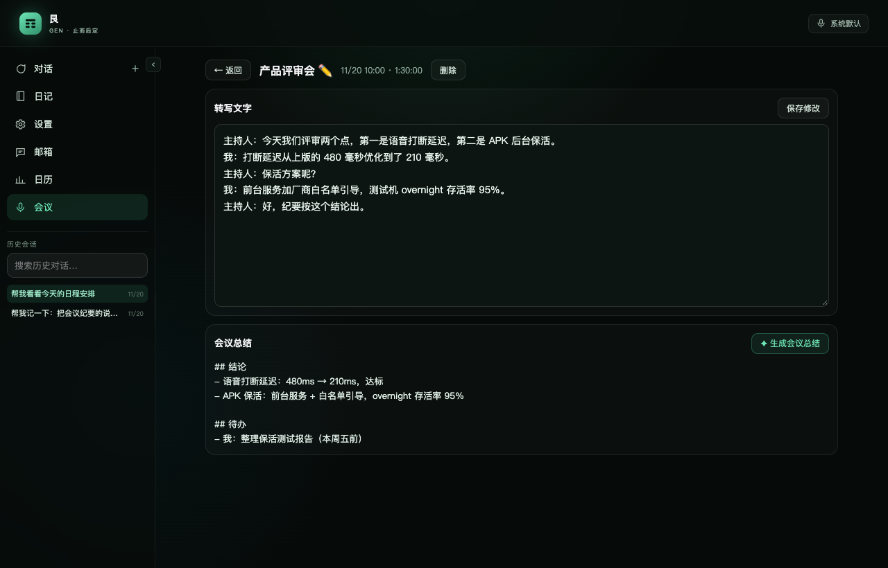
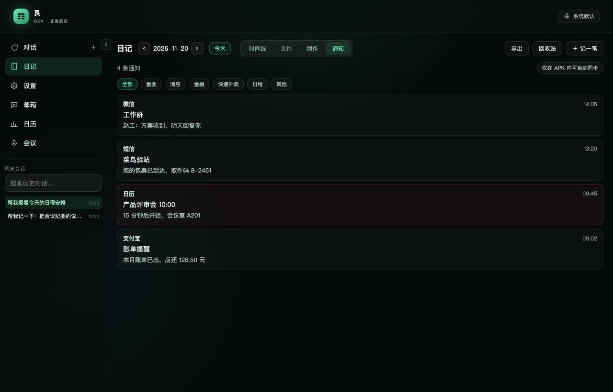
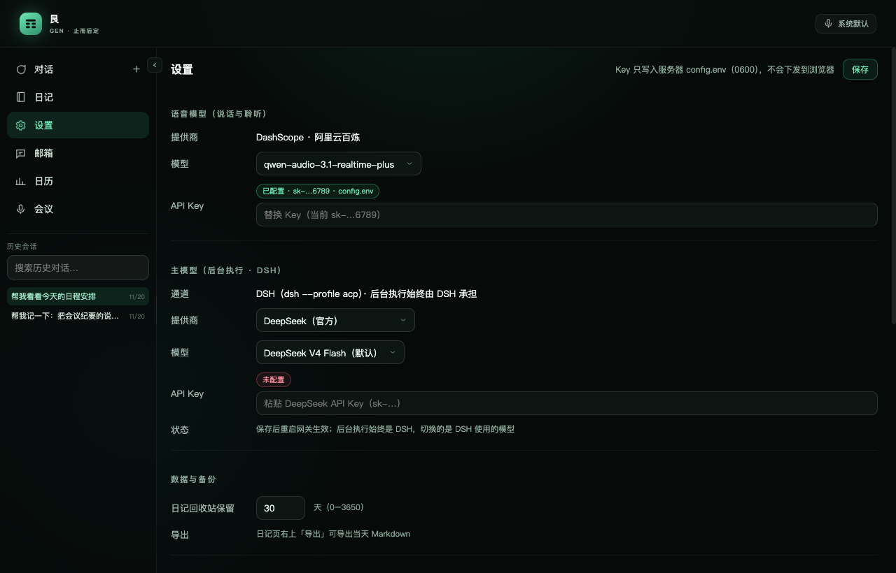

# 艮（Gèn）

**语音优先的个人 AI 助手** —— 实时语音对话、日记、会议录音转写与纪要、通知归档、邮箱、日历。
Web 应用 + Android APK，云端单节点部署，手机与电脑访问同一份数据，**数据只存在你自己的服务器上**。

> 本项目是 [qwen-audio-agent](https://github.com/QwenLM/qwen-audio-agent) 2.1.0 的 fork（Apache-2.0），
> 修改点以 `GEN-MOD` 注释标注；上游说明见 [docs/upstream-README_ZH.md](docs/upstream-README_ZH.md)。
> English README: [README_EN.md](README_EN.md)

| 对话 | 日记 | 会议 |
|---|---|---|
|  |  |  |

| 通知 | 设置 |
|---|---|
|  |  |

## 功能特性

| 模块 | 功能 |
|:---|:---|
| 对话 | 实时语音（全双工）、随时打断、文字输入、图片识别、历史会话、多设备 |
| 日记 | 时间线/文件/创作/通知四视图，五类来源，AI 每日总结，导出，回收站 |
| 会议 | 录音（手机锁屏后台继续）、实时字幕、转写、说话人区分、AI 纪要 |
| 通知 | Android 通知监听 → 分类/脱敏 → 上传 → 日记查看（仅手机 APK） |
| 邮箱 | IMAP 收取、发信、垃圾标记（163 邮箱已适配） |
| 日历 | 待办 / 日程 |
| 设置 | 语音模型/主模型切换、音色试听、语速、手机同步权限 |
| 手机 APK | WebView 外壳 + 通知监听服务 + 锁屏录音前台服务 + JS 桥 |

## 快速开始

### 方式 A：Docker（推荐）

```bash
git clone https://github.com/Longp44/gen-voice-assistant.git
cd gen-voice-assistant
mkdir -p runtime && cp config.env.example runtime/config.env
# 编辑 runtime/config.env，填入 DashScope / DeepSeek API Key
docker compose up -d --build
# 浏览器打开 http://服务器IP:3201
```

### 方式 B：脚本安装（Linux / macOS）

```bash
git clone https://github.com/Longp44/gen-voice-assistant.git
cd gen-voice-assistant
bash scripts/install.sh        # 检查 Node 版本、装依赖、构建、生成 runtime/
vim runtime/config.env         # 填入 API Key
bash scripts/start.sh          # 后台启动；stop.sh 停止
```

要求：Node.js `^22.22.2 || ^24.15.0`（22/24 LTS 或更高）。

### 方式 C：开发者本机

```bash
npm ci && npm run build
QWAUDIO_CONFIG_DIR=./runtime QWAUDIO_STATE_DIR=./runtime/state \
QWAUDIO_DATA_DIR=./runtime/data DSH_HOME=./runtime/dsh-home \
node cli/bin/qwenaudio.mjs gateway
```

## 配置说明

所有密钥集中在 `runtime/config.env`（模板：[config.env.example](config.env.example)）：

| 配置项 | 说明 | 在哪里申请 |
|:---|:---|:---|
| `QWEN_AUDIO_REALTIME_API_KEY` | 阿里云 DashScope Key（实时语音/ASR/视觉，**必需**） | https://bailian.console.aliyun.com/ |
| `QWEN_AUDIO_REALTIME_MODEL` | 默认 `qwen-audio-3.1-realtime-flash` | — |
| `QWEN_AUDIO_REALTIME_VOICE` | 默认音色 `longanqian` | — |
| `DEEPSEEK_API_KEY` | DeepSeek Key（主模型/后台执行/纪要，可选） | https://platform.deepseek.com/ |
| `GEN_PUBLIC_BASE_URL` | 公网地址（媒体 URL 用），默认 `http://127.0.0.1:3201` | — |
| `QWEN_AUDIO_AGENT_ALLOWED_ORIGINS` | 允许的浏览器来源（公网部署必填） | — |
| `GEN_EMAIL_*` | 邮箱 IMAP/SMTP（可选） | — |

完整变量表见 [docs/配置说明.md](docs/配置说明.md)。密钥由使用者自行申请与付费，仓库不提供 Key。

## 手机 APK

APK 是 WebView 外壳，**服务器地址写死在包内**，需自行改代码打包（5 分钟）：

1. 按上面任意方式部署好服务器（建议 HTTPS + 域名）
2. 参照 [docs/手机APK使用.md](docs/手机APK使用.md) 修改 `APP_URL` / `BASE` 两个常量后 `bash build.sh`
3. 安装到手机 → 允许麦克风/相机/通知权限 → 浏览器完成设备配对（见下）
4. 设置 → 手机同步：开启「通知使用权」、电池白名单；会议录音开始后可直接锁屏

设备配对（在服务器上执行，把输出的链接在手机浏览器打开）：

```bash
node cli/bin/qwenaudio.mjs gateway pair --name 我的手机 --endpoint https://your-domain.com
```

## 部署到服务器（systemd + nginx + HTTPS）

模板在 [deploy/](deploy/)：`gen-gateway.service`（含自动重启）、`gen-watchdog`（每分钟看门狗）、
`gen-backup`（每日备份）、`nginx/gen.conf`（HTTPS + WebSocket 反代）。完整步骤见 [docs/部署.md](docs/部署.md)。

## 隐私与安全

- **数据只存在你自己的服务器**：录音、通知、日记均为敏感数据，请部署在自己控制的服务器上
- 公网部署务必启用 HTTPS（Let's Encrypt），并妥善保管设备配对链接
- 通知与录音数据属个人敏感信息，请勿将 `runtime/` 目录暴露或提交到仓库

## 已知限制

- **单用户设计**：按个人使用设计，非多租户 SaaS；多人共享需自行改造鉴权
- **成本**：DashScope 语音/ASR 按量计费（实时约 ¥1–3/小时，文件转写约 ¥0.3/小时），DeepSeek 按 token —— 需自备 Key
- **安卓限制**：通知监听需手动授权；部分厂商会限制后台；锁屏录音依赖前台服务；不支持 iOS
- **浏览器限制**：通知自动采集仅 APK 可用；PWA 只能手动上传
- **外部依赖**：DashScope / DeepSeek 不可用时，语音/对话/纪要会失败
- **DSH 可选**：不安装 [@deepseek-ai/dsh](https://www.npmjs.com/package/@deepseek-ai/dsh) 时，语音对话可用，「后台执行/主模型任务」不可用

## 许可与致谢

- 本项目基于 [qwen-audio-agent](https://github.com/QwenLM/qwen-audio-agent) 2.1.0 fork，**Apache-2.0**，修改以 `GEN-MOD` 标注；保留上游 [LICENSE](LICENSE)、[NOTICE](NOTICE)、[THIRD_PARTY_NOTICES.md](THIRD_PARTY_NOTICES.md)
- 运行依赖 [@deepseek-ai/dsh](https://www.npmjs.com/package/@deepseek-ai/dsh)（MIT，外部安装，不打包）
- 语音能力来自阿里云 [DashScope](https://bailian.console.aliyun.com/)，主模型来自 [DeepSeek](https://platform.deepseek.com/)
